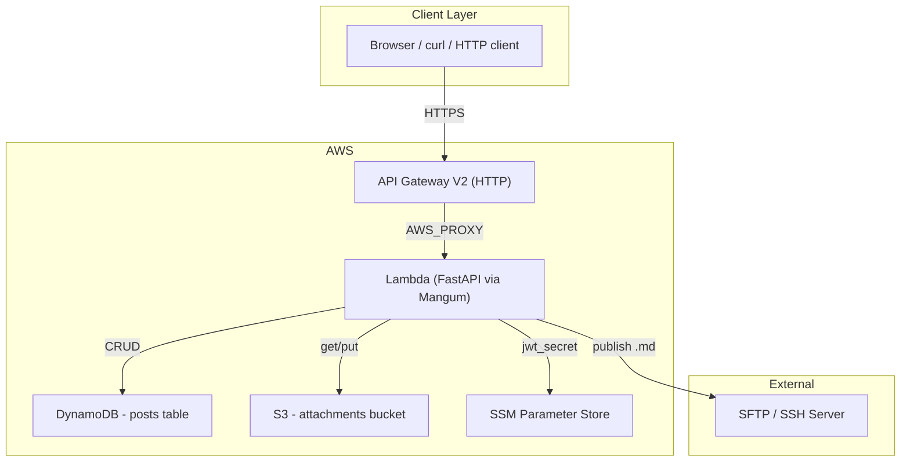
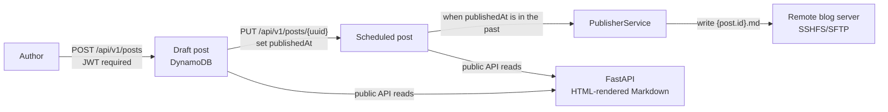
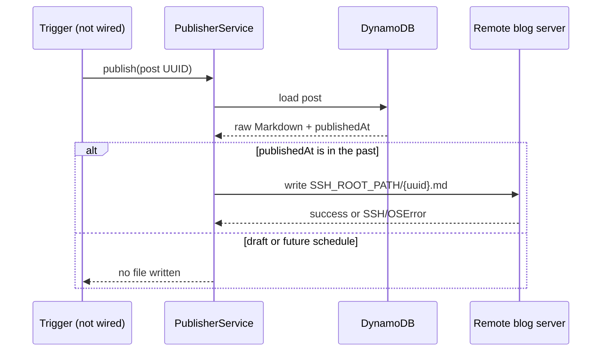
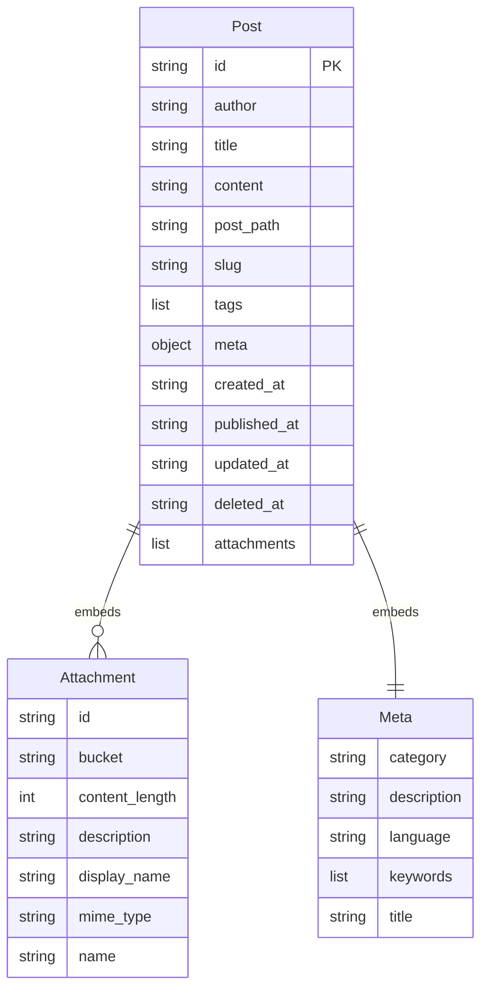
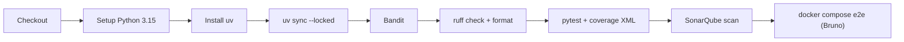

# personal-backend-service

> Serverless blog backend built with FastAPI, deployed on AWS Lambda via Terraform

**Copyright 2024-2026 mobal**

> ⚙️ This README was generated by AI

Licensed under the Apache License, Version 2.0 (the "License");
you may not use this file except in compliance with the License.
You may obtain a copy of the License at

    http://www.apache.org/licenses/LICENSE-2.0

Unless required by applicable law or agreed to in writing, software
distributed under the License is distributed on an "AS B" BASIS,
WITHOUT WARRANTIES OR CONDITIONS OF ANY KIND, either express or implied.
See the License for the specific language governing permissions and
limitations under the License.

---

## Overview

A production-grade personal blog backend. Posts are stored in **DynamoDB**, rendered from Markdown to HTML, and served via a **FastAPI** application running on **AWS Lambda** through **Mangum**. Attachments are stored in a private **S3** bucket and downloaded through stable API links that redirect to signed S3 URLs. Auth is handled via **JWT** (HS256).

---

## Tech Stack

| Category | Technology |
|---|---|
| Framework | FastAPI |
| Runtime | Python 3.15+ |
| API Adapter | Mangum (AWS Lambda + API Gateway V2) |
| Database | DynamoDB (single table, 3 GSIs) |
| Object Storage | S3 (private attachments, stable API download links) |
| Auth | JWT (HS256, Authorization bearer header) |
| Markdown | python-markdown |
| Date/Time | Python stdlib `datetime` |
| Validation | Pydantic v2 (camelCase alias) |
| API Docs | OpenAPI 3.1 (auto-generated) |
| Lint / Format | Ruff |
| Type Checking | ty |
| Security | Bandit |
| CI | GitHub Actions (pytest, SonarQube, Bruno e2e) |
| Deployment | Terraform (AWS) |

---

## Architecture



---

## API Endpoints

All routes are prefixed with `/api/v1`.

The RSS 2.0 feed is available at `/rss.xml`. It includes all published,
non-deleted posts, newest first, with each post's summary and its content
rendered as HTML (`content:encoded`). Set `BLOG_URL` so the items link to the
blog (`{BLOG_URL}/{postPath}`); without it they link to this API.

### Posts

| Method | Path | Auth | Description |
|---|---|---|---|
| POST | `/posts` | JWT | Create a new post |
| GET | `/posts` | No | List published posts (paginated) |
| GET | `/posts/{uuid}` | Optional JWT | Get post by UUID (a valid JWT also returns drafts and scheduled posts) |
| PUT | `/posts/{uuid}` | JWT | Update post |
| POST | `/posts/{uuid}/publish` | JWT | Write post Markdown to the remote blog server |
| DELETE | `/posts/{uuid}` | JWT | Soft-delete post, then remove its attachment files (S3) and published file (blog server) |
| GET | `/posts/archive` | No | Archive grouped by year-month |
| GET | `/posts/{year}/{month}/{day}/{slug}` | No | Get post by date path + slug |

---

## API Documentation (OpenAPI)

The FastAPI app serves an auto-generated OpenAPI 3.1 document describing
every endpoint:

| Path | What |
|---|---|
| `/openapi.json` | Machine-readable schema (JSON) |
| `/docs` | Interactive Swagger UI |
| `/redoc` | ReDoc UI |

The schema is enriched with:

- **App metadata** - title, version, Apache-2.0 license and the API
  conventions (camelCase JSON, error envelope, correlation header) in the
  top-level `description`.
- **Tag groups** - `posts`, `attachments`, and `system` (`/health`).
- **Authentication** - protected operations declare the `HTTPBearer`
  security scheme (`Authorization: Bearer <token>`),
  documented under `components.securitySchemes`.
- **Error responses** - every possible `4xx` references the
  `ErrorResponse` / `ValidationErrorResponse` schemas, matching the real
  error body instead of a generic framework model.
- **Descriptions & examples** - per-operation summaries, path/query
  parameter examples, and full-body request examples on `CreatePost`,
  `UpdatePost` and `CreateAttachment`.

To inspect or export the schema while developing:

```bash
uv run uvicorn app.api_handler:app --port 8080   # terminal 1
curl -s http://localhost:8080/openapi.json | jq . > openapi.json
```

The paths above are served wherever the app runs - local uvicorn as well as
the Lambda/API Gateway deployment.

---

### Attachments

Nested under posts: `/posts/{postUuid}/attachments`

| Method | Path | Auth | Description |
|---|---|---|---|
| POST | `` | JWT | Add attachment (base64) |
| GET | `` | No | List attachments |
| GET | `/{attachmentUuid}` | No | Get attachment metadata |
| GET | `/{attachmentUuid}/download` | No | Redirect to a fresh signed S3 URL |

Attachment metadata in published post responses contains a stable API-relative `url`, such as `/api/v1/posts/{postUuid}/attachments/{attachmentUuid}/download`. Resolve it against the API origin when the frontend is hosted elsewhere. The download endpoint returns an uncached redirect to a freshly signed S3 URL; the stable link does not expire. The S3 bucket and its object listing remain private.

## Posting and publishing

Posting and publishing are separate operations. A post is first saved as a
Markdown document in DynamoDB. The optional `publishedAt` field is then used
to decide whether it belongs in public results, while the publisher sends the
raw Markdown to the blog server over SSHFS/SFTP.



### Create a post

`POST /api/v1/posts` requires a JWT and creates a DynamoDB item. Omit
`publishedAt` (or send `null`) for a draft. The response is `201 Created` with
the new UUID in the `Location` header and no response body.

```bash
curl -i -X POST "$API_URL/api/v1/posts" \
  -H "Authorization: Bearer $JWT" \
  -H "Content-Type: application/json" \
  --data @post.json
```

The request body uses camelCase JSON. The Markdown remains unrendered in
storage; reads convert it to sanitized HTML.

Changing a title also regenerates the slug and date-based `postPath` from the
original creation date. Clients should treat the resulting public URL as
changed after a title update.

### Schedule or publish a post

`PUT /api/v1/posts/{uuid}` is a partial update. Set `publishedAt` to an ISO
8601 timestamp to schedule a post, or to a timestamp in the past to make it
eligible for publishing:

```bash
curl -i -X PUT "$API_URL/api/v1/posts/$POST_ID" \
  -H "Authorization: Bearer $JWT" \
  -H "Content-Type: application/json" \
  --data '{"publishedAt":"2026-09-12T09:00:00+00:00"}'
```

The implemented `PublisherService.publish(post_id)` performs this final
step:



Each due publish attempt records `publishStatus` (`publishing`, `published`,
or `failed`), `publishAttemptedAt`, and `publishError` on the DynamoDB item.
The remote filename is deterministic (`{post.id}.md`), so retrying a failed
publish safely overwrites the same document instead of creating duplicates.

`POST /api/v1/posts/{uuid}/publish` is the explicit authenticated publish
trigger. Updating `publishedAt` controls public visibility; it does not itself
perform the remote write. A scheduler or deployment workflow can call this
endpoint for due posts if automatic publication is required.

### Publishing status and public-read behavior

| Operation | Current behavior |
|---|---|
| `GET /posts` | Includes non-deleted posts whose `publishedAt` is in the past, newest first across pages, up to 100 per page (follow `exclusiveStartKey` for more) |
| `GET /posts/archive` | Groups non-deleted posts whose `publishedAt` is in the past |
| Date/slug reads | Return only non-deleted posts whose `publishedAt` is in the past |
| UUID reads (post and its attachments) | Anonymous: only non-deleted posts whose `publishedAt` is in the past. With a valid JWT: also drafts and scheduled posts, so the `Location` of a new post can be read back. A token that is sent but invalid is rejected with 403. |
| Remote publication | Writes raw Markdown through the authenticated publish endpoint |

The API treats a post as public only when its publication timestamp is due.
Sending `publishedAt: null` through `PUT /posts/{uuid}` returns it to draft
status.

---

## Data Model



**DynamoDB table**: `{stage}-posts`
- Hash key: `id` (UUID)
- GSI `PostPathIndex` on `post_path`
- GSI `TitleIndex` on `title`
- GSI `CreatedAtIndex` on `created_at`

**Soft-delete pattern**: Posts with a non-null `deleted_at` are excluded from all queries. Deleting a post also removes its S3 attachment objects and the published `{id}.md` file on the blog server, best effort: a failure there is logged and does not fail the request (the item itself stays in the table).

**Permalinks**: `slug` and `postPath` are derived from the title and the creation date while a post is a draft or scheduled. Once a post is published its `slug` and `postPath` stay fixed, so renaming it changes the title but not its URL.

---

## Settings (Environment Variables)

Configuration values sourced from env vars. AWS credentials are not application settings: boto3 resolves them from its default chain (the Lambda execution role in production, `AWS_ACCESS_KEY_ID` / `AWS_SECRET_ACCESS_KEY` for local runs).

| Variable | Example |
|---|---|
| `APP_NAME` | personal-backend-service |
| `ATTACHMENTS_BUCKET_NAME` | dev-attachments-xxxxx |
| `AWS_DEFAULT_REGION` | eu-central-1 |
| `BLOG_URL` | `https://blog.example.com` (optional: base URL the feed links to) |
| `BLOG_TITLE` / `BLOG_DESCRIPTION` | Feed title and description (optional, default `Personal Backend Service` / `Published articles`) |
| `DEBUG` | true/false |
| `JWT_SECRET_SSM_PARAM_NAME` | /dev/secrets/jwt |
| `SSH_HOST` / `SSH_USERNAME` / `SSH_ROOT_PATH` | SFTP publish target |
| `SSH_KNOWN_HOSTS` | `blog.example.com ssh-ed25519 AAAA...` (optional, see below) |
| `SSH_PASSWORD_SSM_PARAM_NAME` | `/dev/personal-backend-service/ssh/password` |
| `STAGE` | dev |

Set `SSH_KNOWN_HOSTS` (Terraform: `ssh_known_hosts`) to the publish target's host key in OpenSSH `known_hosts` format, for example the output of `ssh-keyscan -t ed25519 blog.example.com` after comparing it with the key shown on the server. Without it the SFTP connection does not verify the host key, so the password can be captured by anyone able to impersonate the host; every publish logs a warning while it is unset.

Provision the SFTP password as an SSM Parameter Store `SecureString` at the configured parameter name outside Terraform, using the AWS managed `aws/ssm` key. Lambda receives only the parameter name for the password; do not put the password in `.tfvars` or Lambda environment variables. The Lambda role can read only that parameter (plus the JWT parameter). If you use a customer-managed KMS key, grant `kms:Decrypt` on that exact key and allow the Lambda role in its key policy. After deploying the migration, rotate the SFTP account password and update the parameter to invalidate the credential that may remain in older Terraform state snapshots. Password lookups are cached for at most 60 seconds per warm Lambda process.

---

## Middleware

`CorrelationIdMiddleware` injects an `X-Correlation-ID` header from the request, AWS request ID, or a new UUID. The service does not apply geographic restrictions or application-level rate limiting.

Error responses use a standard `ErrorResponse` shape: `{ status, id, message }`.

---

## Terraform Infrastructure

| Resource | Description |
|---|---|
| `aws_apigatewayv2_api` | HTTP API Gateway |
| `aws_lambda_function` | FastAPI handler (Python 3.15, 768 MB, 15 s timeout) |
| `aws_lambda_layer_version` | Dependencies layer (built via Docker) |
| `aws_dynamodb_table` | Posts table with 3 GSIs |
| `aws_s3_bucket` | Private attachments bucket with public access blocked |
| `aws_cloudwatch_log_group` | Lambda logs retained for 7 days |
| `aws_iam_role` / `aws_iam_policy` | Scoped Lambda IAM for DynamoDB, SSM, S3, and CloudWatch logs |
| `aws_lambda_permission` | API Gateway invoke permission |

Production (`stage = "prod"` or `"production"`) enables DynamoDB deletion protection. Point-in-time recovery is disabled to avoid backup charges; enable it if the value of recovery outweighs the added cost. API Gateway/WAF throttling remains disabled per the product requirement to remove rate limiting.

Lambda logs use CloudWatch Logs' default encryption at rest and are retained for `log_retention_days` (7 days by default). Custom KMS keys, API Gateway access-log ingestion, alarms, and custom metrics are omitted to keep recurring costs low. API Gateway access logging can be enabled later if operational needs justify the ingestion and retention costs.

The Lambda artifacts are built inside the versioned `public.ecr.aws/lambda/python:3.15.2026.11.11.16` base image, the same interpreter the function runs on (AWS has not published a SAM build image for Python 3.15 yet). The image has no `zip` binary, so `scripts/zip_directory.py` assembles the archives. Build scripts install pinned uv `0.12.19`; the locked runtime layer includes boto3 and aws-lambda-powertools, while tests and typing tools remain development-only. `make build` checks ZIP size and required imports, then imports `app.api_handler` from the exact assembled API ZIP and dependency layer using Python 3.15.

---

## CI/CD Pipeline (GitHub Actions)

`.github/workflows/ci.yml` runs on every push. The `build-and-test` job
mirrors the Makefile targets; the `bruno` job (needs `build-and-test`)
replays the Docker end-to-end suite, and a separate infrastructure job checks
OpenTofu formatting/validation and TFLint.



Stages (`build-and-test`):
- **Bandit** (high severity, high confidence)
- **ruff** (lint + format check)
- **pytest** (branch coverage; XML report uploaded to Codecov/SonarQube)
- **SonarQube** (Python analysis + coverage)

Docker end-to-end (`bruno` job):
- Builds the app image and the AWS Emulator image (DynamoDB, SSM, S3) and starts
  both; the app seeds the emulator with `scripts/init_emulator.py` on start
- Gates on the app's healthcheck and runs the Bruno
  collection in `bruno/` with the Bruno CLI, inside the emulator's network namespace (`/health`, post CRUD, archive, auth failures,
  attachments)

---

## Quick Start

```bash
# Install dependencies
uv sync

# Run locally (hot-reload)
uv run uvicorn app.api_handler:app --reload --port 8080

# Run tests
pytest

# Unit tests only
pytest tests/unit

# Integration tests only
pytest tests/integration

# Lint
uv run ruff check app/ tests/

# Format
uv run ruff format --check app/ tests/

# Type check
uv run ty check

# Security scan
uv run bandit --severity-level high --confidence-level high -r app/
```

### Running locally with AWS Emulator

The app needs DynamoDB, S3 and SSM, which [AWS Emulator](https://docs.aws.amazon.com/emulator/latest/userguide/)
(CC0, runs in Docker) provides. AWS publishes no prebuilt image, so compose builds
`docker/aws-emulator/Dockerfile` (the documented recipe, installing `LTS/latest`; rebuild
to pick up new releases). On ARM, build with `--build-arg EMULATOR_RPM=aws-emulator-aarch64.rpm`.
State is kept in memory: stopping the emulator wipes it.

The emulator only serves HTTPS and its self-signed certificate is valid for `localhost`
and `127.0.0.1` only. `docker-compose.yml` therefore starts the emulator and the app
together, with the app in the emulator's network namespace so it can reach the
endpoint as `https://127.0.0.1:9297`:

```bash
docker compose up -d --build --wait app
curl localhost:8080/health

# Bruno collection (see "API tests with Bruno" below): the CLI must share the
# namespace (presigned URLs point at 127.0.0.1:9297) and skip the self-signed
# certificate check
docker run --rm --network "container:$(docker compose ps -q emulator)" \
  -v "$PWD/bruno:/bruno:ro" usebruno/cli:4.3.0 run --env e2e -r \
  --env-var baseUrl=http://localhost:8080 --insecure

docker compose down -v
```

The app is published through the `emulator` service (`http://localhost:8080`; from other
containers `http://emulator:8080`).

To run the app on the host instead (for example with `--reload`), start only the emulator
and seed it by hand:

```bash
docker compose up -d --build --wait emulator

export AWS_ENDPOINT_URL=https://127.0.0.1:9297
export AWS_CA_BUNDLE="$(mktemp)"
docker compose cp emulator:/home/emulator/.aws/emulator/9297/ca.pem "$AWS_CA_BUNDLE"
export AWS_DEFAULT_REGION=eu-central-1 AWS_ACCESS_KEY_ID=test AWS_SECRET_ACCESS_KEY=test
export STAGE=e2e APP_NAME=personal-backend-service ATTACHMENTS_BUCKET_NAME=attachments
export DEBUG=true
export JWT_SECRET_SSM_PARAM_NAME=/e2e/secrets/jwt
export SSH_HOST=localhost SSH_USERNAME=ci SSH_ROOT_PATH=/root
export SSH_PASSWORD_SSM_PARAM_NAME=/e2e/personal-backend-service/ssh/password

uv run python -m scripts.init_emulator   # table, bucket and SSM parameters
uv run uvicorn app.api_handler:app --reload --port 8080
```

Notes:
- Emulator health: `curl --cacert "$AWS_CA_BUNDLE" https://127.0.0.1:9297/__admin/health` returns `ok`.
- After restarting the emulator, seed it again and restart the app (new CA, empty state).
- The Bruno CLI needs `--insecure` against it, because the presigned S3 download check
  follows an HTTPS URL with the self-signed certificate. The emulator is pinned to
  nothing: the Dockerfile installs `LTS/latest`, so rebuild to pick up new releases.

### API tests with Bruno

`bruno/` is a [Bruno](https://www.usebruno.com/) collection in OpenCollection YAML. It
covers 29 requests (59 tests): `/health`, post CRUD, list, archive, RSS, auth failures and
attachments. Open the folder in the Bruno app, or run it with the CLI as shown above.

```
bruno/
├── opencollection.yml       # collection config, docs and the pre-request script that mints JWTs
├── environments/e2e.yml     # baseUrl, jwtSecret, jwtAudience, jwtSubject
├── health/                  # one folder per area; folder.yml sets the run order (seq)
├── posts/
└── attachments/
```

- Requests share state (`postId`, `attachmentId`, ...) through runtime variables, so run a
  whole folder, or the whole collection with `-r`, in order.
- The service never issues tokens: the collection-level script signs HS256 JWTs with
  `jwtSecret` (the e2e sample from `.env.example`). Override `baseUrl` with
  `--env-var baseUrl=...` to test a deployed API Gateway URL.
- "Get attachment download — redirect" turns redirect following off to assert the 302;
  the next request downloads the presigned URL.
- The Docker image is pinned (`usebruno/cli:4.3.0`). Bump it deliberately, and re-run the
  collection when you do.

Following Bruno's [Git strategies](https://docs.usebruno.com/git-integration/git-strategies)
guide, this is a collection-level setup: the collection lives in the repository of the one
service it tests and is versioned with it, so there is no separate workspace or collection
repository to keep in sync. Moving it into a shared Bruno workspace later only needs
`bruno/` to be connected to that workspace.

---

## Makefile

Run `make` or `make help` to list the targets (help is the default goal).

| Target | Description |
|---|---|
| `help` | List the targets with their descriptions |
| `all` | bandit + format + lint + test |
| `build` | Build Lambda deployment package + layer (Docker) |
| `format` | `ruff format app/ tests/` |
| `install` | `uv sync` |
| `lint` | `ruff check app/ tests/ --fix` |
| `test` | pytest with branch coverage (DynamoDB/SSM/S3 via moto) |
| `tflint` | Terraform lint (`infrastructure/`) |
| `bandit` | Security scan |
| `ty` | Static type check |

---

## Project Structure

```
app/
├── api_handler.py          # FastAPI app, Mangum handler, error handlers
├── dependencies.py         # DI providers (services, repositories, JWT)
├── settings.py             # Pydantic settings (env vars + SSM secrets)
├── jwt_bearer.py           # JWT auth (Authorization bearer header)
├── middlewares.py          # Correlation ID
├── exceptions.py           # PostNotFoundException, AttachmentNotFoundException, etc.
├── api/
│   └── v1/
│       ├── api.py          # /api/v1 router mount (posts, attachments)
│       └── routers/
│           ├── posts_router.py        # 8 post endpoints (OpenAPI annotated)
│           └── attachments_router.py  # 4 attachment endpoints (OpenAPI annotated)
├── models/
│   ├── auth.py             # JWTToken model
│   ├── post.py             # Post, Attachment, Meta models
│   ├── response.py         # API envelope models (Post, Page, ErrorResponse)
│   └── camel_model.py      # CamelCase alias generator
├── schemas/
│   ├── post_schema.py      # CreatePost, UpdatePost (descriptions + examples)
│   └── attachment_schema.py # CreateAttachment (descriptions + examples)
├── services/
│   ├── post_service.py         # Business logic (CRUD, archive, markdown)
│   ├── attachment_service.py   # S3 upload + post attachment link
│   ├── publisher_service.py    # SFTP publish via SSHFS
│   ├── s3_storage_service.py   # S3 CRUD wrapper
│   └── sshfs_storage_service.py# SSHFS storage wrapper
└── repositories/
    └── post_repository.py  # DynamoDB data access

tests/
├── unit/
│   ├── service/            # Unit tests per service
│   ├── repository/         # PostRepository tests
│   └── test_auth.py        # JWT auth tests
└── integration/
    ├── test_posts_api.py
    └── test_attachments_api.py

terraform/*.tf              # Infra: API Gateway, Lambda, DynamoDB, S3, IAM

.github/workflows/ci.yml    # CI: Bandit, Ruff, pytest, SonarQube, Bruno e2e
bruno/                      # Bruno e2e collection (OpenCollection YAML)
scripts/                    # emulator seeding, Lambda build/packaging
```

---

## Key Design Decisions

- **Markdown rendering on read** - Content is stored as Markdown and rendered to HTML only when fetched. This keeps raw source available for SFTP publishing.
- **CamelCase API** - Pydantic `alias_generator=to_camel` lets Python use snake_case internally while exposing camelCase JSON.
- **Embedded attachments** - Attachments are stored as a list within the Post DynamoDB item (no separate table).
- **Soft-delete** - `deleted_at` timestamp; deleted posts are filtered out via DynamoDB `FilterExpression`.
- **SFTP publisher** - `PublisherService` uses `sshfs` to write `.md` files to a remote server after their `published_at` is in the past.
- **JWT from SSM** - The JWT secret is fetched from AWS SSM Parameter Store at runtime, not stored in env.
