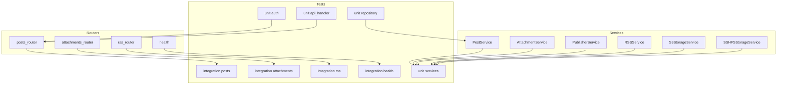

# Integration & Test Suite Review

- **Date:** 2026-11-11
- **Scope:** `tests/`, cross-referenced against `app/`
- **Baseline:** integration suite green (44 passed); full suite has 2 pre-existing unit failures; lint/format/ty/bandit/tflint all green.
- **Verdict:** Good breadth on the happy paths and auth. The main weaknesses are two date-dependent (currently failing) unit tests, a false-positive pagination test, thin update/publish coverage, missing negative-state reads (draft/future/deleted) on the public read paths, and several untested modules (`CorrelationIdMiddleware`, request-validation handler, `update_publish_state`).

## Test Suite Inventory

| Layer | File | Tests | What it covers |
|-------|------|-------|----------------|
| Integration | [`tests/integration/test_health_api.py`](../tests/integration/test_health_api.py) | 1 | Health check does not touch dependencies |
| Integration | [`tests/integration/test_posts_api.py`](../tests/integration/test_posts_api.py) | 20 | CRUD, auth, archive, path lookup, publish (mocked) |
| Integration | [`tests/integration/test_attachments_api.py`](../tests/integration/test_attachments_api.py) | 19 | Upload, publication states, download redirect, listing |
| Integration | [`tests/integration/test_rss_api.py`](../tests/integration/test_rss_api.py) | 1 | Ordering, future/deleted exclusion, link, encoded content |
| Unit | [`tests/unit/test_api_handler.py`](../tests/unit/test_api_handler.py) | 2 | Exception handlers do not log tracebacks |
| Unit | [`tests/unit/test_auth.py`](../tests/unit/test_auth.py) | 17 | JWT parsing/validation matrix |
| Unit | [`tests/unit/repository/test_post_repository.py`](../tests/unit/repository/test_post_repository.py) | 20 | DynamoDB access, pagination, concurrency |
| Unit | [`tests/unit/service/`](../tests/unit/service) | 50+ | Post, attachment, publisher, RSS, S3, SSHFS services |

## High-Priority Issues

### 1. Two date-dependent unit tests fail today

[`test_get_post_by_post_path_falls_back_to_unpadded_path`](../tests/unit/service/test_post_service.py:420) and
[`test_fail_to_get_post_by_post_path_due_post_not_found_exception`](../tests/unit/service/test_post_service.py:443)
derive the path from `datetime.now()` through the `posts` fixture. On a date such as 2026-11-11 the padded path
`2026/11/11/...` equals the unpadded path `2026/11/11/...`, so
[`_post_path_candidates`](../app/services/post_service.py:196) yields a single candidate while the tests assert two
lookups.

- **Impact:** Time-dependent failures; they pass only when the month or day is a single digit.
- **Fix:** Pin `published_at` to a deterministic date with single-digit month/day (e.g. `2026-02-03`) so padded and
  unpadded differ, or generate the post from a fixed timestamp.

### 2. Pagination test is a false positive

[`test_successfully_get_archive_paginated_with_exclusive_start_key`](../tests/unit/service/test_post_service.py:370)
mocks `get_posts` to return the same full list on every call, ignoring `exclusive_start_key`. It then asserts the
second page equals the full list, so it never verifies continuation.

- **Fix:** Use `side_effect` to return distinct pages, and assert `get_posts` was called with
  `{"id": <exclusive_start_key>}` on the second call.

### 3. Update integration test barely exercises update logic

[`test_successfully_update_post`](../tests/integration/test_posts_api.py:369) submits `posts[0].model_dump()` (the same
title), so [`_prepare_title_update`](../app/services/post_service.py:264) returns early.

- **Missing:** title change → `slug`/`post_path` regeneration, duplicate-title 409, same-title no-op.

## Coverage Gaps

### Posts API (integration)

- [`GET /posts`](../tests/integration/test_posts_api.py:42) never asserts that **draft, future-dated, and soft-deleted**
  posts are excluded, nor the `exclusive_start_key` paging round trip / `Page.exclusive_start_key`.
- Get-by-UUID 404 covers future posts only; **draft (null `published_at`)** and **deleted** are not covered.
- Get-by-path 404 covers a random/unknown date only; **draft/deleted/future** paths are not covered.
- **Legacy unpadded `post_path` in storage** is never exercised end-to-end. The route regex forces padded input, so the
  unpadded fallback only matters for stored data; seed an unpadded `post_path` and read it via the padded route.
- [`GET /posts/archive`](../tests/integration/test_posts_api.py:98) covers one current month with everything published.
  Missing: multi-month grouping, `max_results` cap, exclusion of unpublished/deleted.
- Create asserts only 201 + `Location`; no **create → GET round trip** (derived `slug`/`postPath`, empty `attachments`,
  rendered `content`).
- No HTTP-level **markdown rendering / XSS sanitization** assertion (unit-only).
- Missing 422 cases: `publishedAt` without timezone, empty `tags`, whitespace-only fields.
- Publish endpoint: only the mocked success path. Missing **403 unauthenticated**, **404 missing**, **500 failure**.
- Delete of an **already-deleted** post → 404 is not covered.

### Attachments API (integration)

- Draft unavailability is tested for **list** only. Missing **download** and **get-by-id** 404 for draft/future/deleted
  posts (all should 404 via [`get_published_post_by_uuid`](../app/services/post_service.py:160)).
- No assertion that the object actually landed in S3 (key/content/content-disposition/MIME) or that the post's
  `attachments` was updated; [`test_successfully_add_attachment`](../tests/integration/test_attachments_api.py:33) only
  checks 201.
- `Location` header format is not asserted and not followed.
- Not covered: 5 MB boundary (exactly 5 MB success, > 5 MB 422), unknown extension →
  `application/octet-stream`, filename sanitization (`../../x`), `displayName` defaulting to `name`.
- [`test_download_redirects_to_fresh_signed_url`](../tests/integration/test_attachments_api.py:237) checks the signature
  and expiry but never fetches the presigned URL to confirm it resolves.

### RSS

- [`test_rss_api`](../tests/integration/test_rss_api.py:15) covers ordering, future, and deleted, but not **draft
  (null `published_at`)** exclusion, empty feed, `pubDate` format, or XML escaping.
- [`test_rss_service`](../tests/unit/service/test_rss_service.py:8) is a single test; the `continue` branch for missing
  `post_path`/`published_at` and the naive-datetime normalization in
  [`_published_at`](../app/services/rss_service.py:53) are untested.

### Service, handler, and middleware

- [`CorrelationIdMiddleware`](../app/middlewares.py:16) has **no tests**: `X-Correlation-ID` echo/generation, the
  contextvar, and the AWS-context fallback are unverified. No integration test asserts the documented
  `X-Correlation-ID` response header.
- [`request_validation_error_handler`](../app/api_handler.py:135) and the generic exception path are untested in
  [`test_api_handler.py`](../tests/unit/test_api_handler.py:9); the `{status,id,message,errors}` body shape is unchecked.
- [`update_publish_state`](../app/services/post_service.py:283) has no direct unit test; the deleted-post publish path
  is untested.
- [`_delete_uploaded_object`](../app/services/attachment_service.py:133) swallow-and-log behavior on cleanup failure is
  untested.
- Archive `max_results` semantics in
  [`_sort_dates_and_group_by_month`](../app/services/post_service.py:307) look questionable (the limit resets per
  month, so it does not cap across months) and are untested across multiple months.
- No test that two **different titles slugifying to the same slug** collide on `post_path`
  (e.g. `Hello World` vs `Hello, World!`).

## Test-Quality & Fixture Concerns

- [`test_client`](../tests/integration/conftest.py:7) is `scope="module"` while the autouse `mock_aws` fixture is
  function-scoped. Combined with [`get_settings`](../app/dependencies.py:21) being `@lru_cache`, a `Settings` instance
  (and its cached `jwt_secret`) is shared across tests in a worker. It works today only because the value is constant —
  latent order/environment coupling.
- Non-determinism from `faker` / `datetime.now()` in fixtures and the random date in
  [`test_fail_to_get_post_by_date_and_slug_due_to_not_found`](../tests/integration/test_posts_api.py:138).
- [`test_fail_expired_jwt_token_cause_forbidden`](../tests/integration/test_posts_api.py:443) encodes a token missing
  `iat/aud/jti`, conflating "expired" with "missing claims".
- Several assertions use subset checks (`post_response.items() <= ...`) that silently ignore unexpected extra/missing
  fields; camelCase keys and `exclude_none` are only implicitly covered.

## Source Concern Surfaced During Review

[`app/services/sshfs_storage_service.py`](../app/services/sshfs_storage_service.py:26) renders as
`except SSHError, OSError:` (invalid in Python 3). The SSHFS tests import and pass, so this is almost certainly a
display artifact, but a one-line `py_compile` check is worthwhile.

## Coverage Map

## Remediation Plan

1. Fix the two date-dependent failing tests with a fixed `published_at` (e.g. `2026-02-03`).
2. Rewrite the archive pagination test to assert `exclusive_start_key` forwarding and distinct pages.
3. Strengthen update coverage: title change (slug/`post_path`), duplicate-title 409, same-title no-op.
4. Add `GET /posts` integration tests for draft/future/deleted exclusion and `exclusive_start_key` paging.
5. Add get-by-UUID and get-by-path 404 tests for draft, future, and deleted posts.
6. Add an integration test with a legacy unpadded `post_path`.
7. Expand archive tests for multi-month grouping, `max_results`, and unpublished/deleted exclusion.
8. Add a create-to-get round-trip test (slug, `postPath`, `attachments`, rendered content).
9. Add publish tests for unauthenticated 403, missing post 404, and failure 500.
10. Add attachment tests for download/get-by-id 404 on draft/future/deleted, and verify S3 object + `post.attachments`.
11. Add attachment boundary tests (exactly 5 MB, over-limit, unknown MIME, sanitization, `displayName`, `Location`).
12. Expand RSS tests (draft exclusion, empty feed, `pubDate`, XML escaping, missing-field branches).
13. Add `CorrelationIdMiddleware` unit tests and an integration assertion of `X-Correlation-ID`.
14. Add `api_handler` tests for `request_validation_error_handler` and the generic exception path.
15. Add unit tests for `update_publish_state` and attachment cleanup-failure logging.
16. Resolve archive `max_results` semantics and add multi-month tests.
17. Add a slug-collision-on-`post_path` test.
18. Reduce fixture non-determinism and document/tighten the module-scoped `test_client` + `lru_cache` interaction.
19. Verify the `except` tuples in `app/services/sshfs_storage_service.py` are parenthesized.
